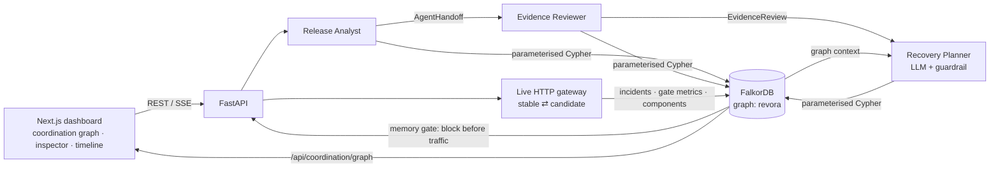

# revora

**ai remembers. revora learns.** · Graph Hacks — **Track 2: Agent Memory and Coordination** · powered by FalkorDB

Demo video: [`docs/artifacts/revora-demo.mp4`](docs/artifacts/revora-demo.mp4) · Public replay: [revora-anvitdevadiga.vercel.app](https://revora-anvitdevadiga.vercel.app) · Full technical reference: [docs/TECHNICAL.md](docs/TECHNICAL.md)

**The problem.** Agents that run infrastructure forget. A release agent that rolled back `v7` at 2am will ship `v7` again at 3am, and it will happily ship `v8` too, even though `v8` carries the same broken SDK. Meanwhile the agent that planned the fix has no durable way to see what the measuring agent observed.

**What revora does.** Three agents (Release Analyst → Evidence Reviewer → LLM Recovery Planner) operate a live HTTP gateway and coordinate *only* through FalkorDB. Every incident, handoff, review, decision and shipped component is a graph node. Before a candidate serves a single request, revora traverses the graph:

- **Same version failed before?** → blocked, linked with `BASED_ON`.
- **Shares a component that only ever appeared in failed releases?** → blocked, via `(new)-[:USES]->(component)<-[:USES]-(failed release)`.

Zero requests reach the bad candidate. Remove the graph and the same retry serves HTTP 503.


## Why FalkorDB is the engine, not decoration

| Agent decision | Graph read that drives it |
|---|---|
| Block a retried version | `ReleaseIncident {service, version}` lookup before any traffic |
| Block a *new* version that shares a failed component | 2-hop `USES` traversal, excluding components that ever shipped healthy |
| Planner proposes and explains recovery | Recent incidents, their components and `BASED_ON` links are retrieved and given to the LLM as context |
| Planner runs in another process | Reads the analyst's persisted `AgentHandoff` back from FalkorDB |
| Backend restarts mid-incident | `ReleaseControllerState` restores the route and the in-flight incident |

Each handoff, review and decision is written in **one** Cypher mutation, so a crash never leaves a half-recorded coordination step.

## Architecture



| Agent | Kind | Reads from graph | Writes to graph |
|---|---|---|---|
| Release Analyst | deterministic | active incident | `AgentHandoff` + `HANDED_OFF` |
| Evidence Reviewer | deterministic | handoff, raw HTTP samples | `EvidenceReview` + `REVIEWED_BY` |
| Recovery Planner | **LLM (Groq)** behind a guardrail | handoff, review, recent incidents, components, prior plans | `CoordinationDecision` with `proposed_action`, `guardrail`, `BASED_ON`, `RETRIEVED`, `EXECUTED` |

The planner proposes one allowlisted action and cites graph IDs. The guardrail accepts the proposal only if it matches what the measured evidence requires; otherwise it records `vetoed`. The model never picks a tool, URL or command. Without `GROQ_API_KEY`, the planner runs deterministically.

## Quick start

```sh
cp .env.example .env          # optional: add GROQ_API_KEY for the LLM planner
docker compose up -d --build  # FalkorDB + FastAPI + Next.js on localhost
```

Open http://localhost:3000 → **Live workspace** → **Connect** (`http://localhost:8000`). Stop with `docker compose stop`; graph memory persists in the named volume.

| Variable | Default | Purpose |
|---|---|---|
| `FALKORDB_URL` | set by Compose | e.g. `falkor://falkordb:6379`; required when `APP_ENV=production` |
| `FALKORDB_GRAPH` | `revora` | Graph name |
| `GROQ_API_KEY` | empty | Enables the LLM Recovery Planner (and the optional Groq agent panel) |
| `GROQ_MODEL` / `GROQ_PLANNER_MODEL` | `openai/gpt-oss-20b` | Model for the agent panel / planner override |
| `REVORA_API_KEY` | empty | Workspace key sent as `x-api-key` |
| `ALLOW_ANONYMOUS` | `false` | Allow calls without a key (local only) |
| `APP_ENV` / `ALLOW_MEMORY_FALLBACK` | `development` / `true` | Production disables the in-memory fallback |
| `REVORA_SERVICE_NAME` | `revora-demo` | Service scope for incidents |
| `REVORA_STABLE_URL` / `REVORA_CANDIDATE_URL` | empty | Gate two real services instead of the built-in demo |
| `CORS_ORIGINS` | `http://localhost:3000,http://127.0.0.1:3000` | Allowed frontend origins (add your hosted URL) |

## The demo in five steps

1. **Introduce failure.** Inject `v7` shipping `base@1, payments-sdk@2.1`. The live gateway serves HTTP 503.
2. **Investigate, hand off & restore.** The analyst measures 12 requests, the reviewer recomputes the gates from raw samples, and the LLM planner proposes rollback citing the graph. The guardrail accepts, stable is restored, and HTTP 200 is verified.
3. **Retry v7.** Blocked from memory with 0 probes; the new incident is linked `BASED_ON` to the rollback.
4. **Ship v8 with the same SDK.** It's a different version but is still blocked: it `USES` `payments-sdk@2.1`, which only ever appeared in failed releases. `base@1` is ignored because it also shipped in a healthy release.
5. **Click any node** in the coordination graph to see its properties, its edges and the exact Cypher that wrote it.

## Graph model

```mermaid
graph LR
  C1[Component<br/>payments-sdk@2.1]
  I3["ReleaseIncident<br/>v8 · blocked"] -- USES --> C1
  I2["ReleaseIncident<br/>v7 · blocked"] -- BASED_ON --> I1
  I3 -- BASED_ON --> I1["ReleaseIncident<br/>v7 · rollback<br/>error_rate · p95_latency_ms"]
  I1 -- USES --> C1
  I1 -- HANDED_OFF --> H[AgentHandoff]
  H -- REVIEWED_BY --> R[EvidenceReview]
  R -- FORWARDED_TO --> D["CoordinationDecision<br/>proposed_action · guardrail"]
  H -- HANDED_OFF_TO --> D
  D -- BASED_ON --> I1
  D -- EXECUTED --> I1
  D -. RETRIEVED .-> H0[prior AgentHandoff]
```

## Key Cypher (from `backend/app`)

```cypher
-- 1. exact-version memory gate, read before any candidate traffic
MATCH (i:ReleaseIncident {service:$service, version:$version})
WHERE i.decision IN ['rollback','promote']
RETURN i.id, i.timestamp, i.failed ORDER BY i.timestamp DESC LIMIT 1

-- 2. multi-hop component gate: shared with a failed release, never shipped healthy
MATCH (c:Component) WHERE c.key IN $components
MATCH (c)<-[:USES]-(bad:ReleaseIncident {service:$service, decision:'rollback', failed:true})
WHERE bad.version <> $version
  AND NOT (c)<-[:USES]-(:ReleaseIncident {service:$service, decision:'promote'})
RETURN c.key, bad.id, bad.version

-- 3. incident + memory link + components, one mutation
MERGE (i:ReleaseIncident {id:$id}) SET i.version=$version, i.decision=$decision,
  i.error_rate=$error_rate, i.p95_latency_ms=$p95_latency_ms
WITH i OPTIONAL MATCH (prior:ReleaseIncident {id:$prior_id})
FOREACH (_ IN CASE WHEN prior IS NULL THEN [] ELSE [1] END | MERGE (i)-[:BASED_ON]->(prior))
FOREACH (key IN $components | MERGE (c:Component {key:key}) MERGE (i)-[:USES]->(c))

-- 4. review + planner decision + provenance, one mutation
MATCH (i:ReleaseIncident {id:$incident_id})-[:HANDED_OFF]->(h:AgentHandoff {id:$handoff_id})
CREATE (r:EvidenceReview {id:$review_id, status:$review_status}) CREATE (h)-[:REVIEWED_BY]->(r)
CREATE (d:CoordinationDecision {id:$id, action:$action, planner_source:$planner_source,
        guardrail:$guardrail, proposed_action:$proposed_action})
CREATE (r)-[:FORWARDED_TO]->(d) CREATE (h)-[:HANDED_OFF_TO]->(d) CREATE (d)-[:BASED_ON]->(i)

-- 5. planner context: what the LLM is shown
MATCH (i:ReleaseIncident {service:$service})
WHERE i.decision IN ['rollback','blocked_from_memory','promote']
WITH i ORDER BY i.timestamp DESC LIMIT 6
OPTIONAL MATCH (i)-[:USES]->(c:Component)
OPTIONAL MATCH (i)-[:BASED_ON]->(p:ReleaseIncident)
RETURN i.id, i.version, i.decision, i.error_rate, collect(DISTINCT c.key), collect(DISTINCT p.id)

-- 6. live coordination view (GET /api/coordination/graph)
MATCH (i:ReleaseIncident {service:$service}) WITH i ORDER BY i.timestamp DESC LIMIT $limit
OPTIONAL MATCH (i)-[:HANDED_OFF|REVIEWED_BY|FORWARDED_TO|HANDED_OFF_TO
                   |BASED_ON|EXECUTED|RETRIEVED|USES*1..4]-(n)
WITH collect(DISTINCT i) AS seeds, collect(DISTINCT n) AS reached
WITH seeds + [n IN reached WHERE NOT n IN seeds] AS ns
UNWIND ns AS a OPTIONAL MATCH (a)-[r]->(b) WHERE b IN ns
RETURN ns, collect(DISTINCT r)
```

All values are query parameters; labels and relationship types are fixed in source. Range indexes cover every lookup key.

## Main API

| Endpoint | What it does |
|---|---|
| `POST /api/release/inject` | `{version, mode, components}`: activate a faulty candidate, or block it from memory |
| `POST /api/coordination/recover` | Analyst → reviewer → planner handoff, then guarded recovery |
| `POST /api/release/run` | Off-route preflight gate (`force_recheck` overrides memory for a repaired build) |
| `GET /api/coordination/graph` | Live coordination subgraph for the UI |
| `GET /api/release/history` · `/api/coordination/history` | Incident trail and saved handoffs |
| `GET /api/release/traffic` | What a real caller receives (returns the actual HTTP status) |

## Verify

```sh
cd backend && python3.12 -m venv .venv && . .venv/bin/activate
pip install -r requirements-dev.txt && python -m pytest       # unit + API tests
FALKORDB_URL=falkor://127.0.0.1:6379 PYTHONPATH=. python tests/integration_submission.py
cd ../frontend && npm ci && npm run build
```

The integration script restarts the API mid-incident against real FalkorDB and checks restored-state recovery, graph links, ablations, and adverse-memory rejection.

## Scope

revora is a single-workspace, single-worker system that gates a project-owned (or one operator-configured) service pair. The fault is intentionally injected; HTTP traffic, measurements, routing and recovery are real. More experiments (customer-migration learning proof, memory ablations, the Groq tool-calling agent, and the replay lab) and the full operating limits are in [docs/TECHNICAL.md](docs/TECHNICAL.md) and [docs/SUBMISSION_AUDIT.md](docs/SUBMISSION_AUDIT.md).

## Project lead and AI assistance

**Project lead: Anvit Devadiga.** Anvit set revora's product direction and priorities, reported issues throughout development, and guided revisions through ongoing feedback and review. OpenAI Codex and Claude Code assisted with repository review, backend and frontend implementation, debugging, test support, and documentation. Anvit is responsible for the final design and submitted work.
