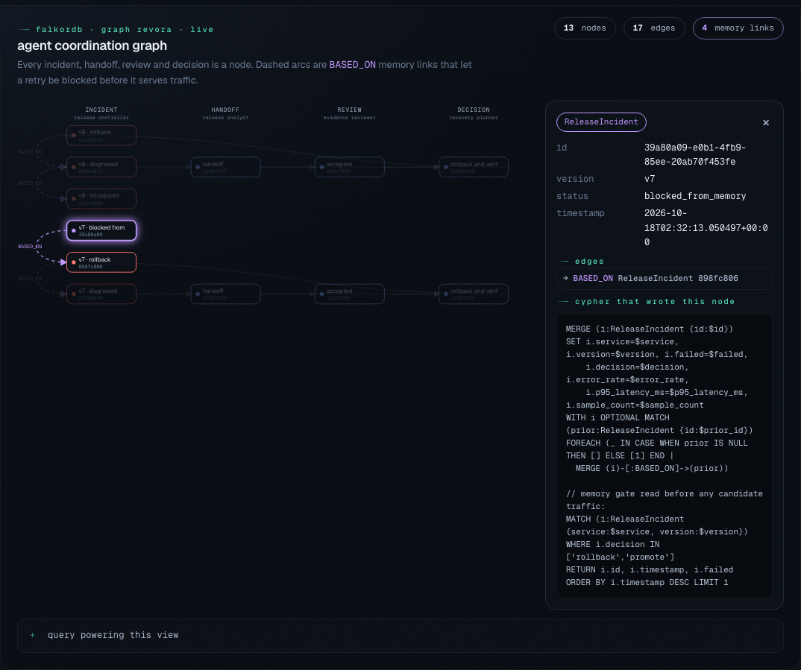
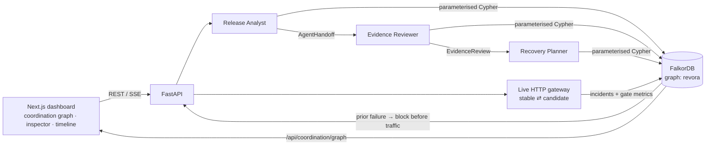
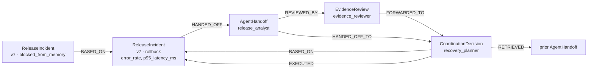

# revora: technical reference

The one-page overview is in the [README](../README.md). This file keeps the full detail on every workflow, API, and boundary.

**ai remembers. revora learns.**

Demo video: [youtu.be/ezqdiSkRHpM](https://youtu.be/ezqdiSkRHpM) — the ~3 minute walkthrough of the live incident loop (recording script and shot list: [`docs/DEMO_SCRIPT.md`](DEMO_SCRIPT.md)). Public replay: [revora-anvitdevadiga.vercel.app](https://revora-anvitdevadiga.vercel.app); fresh execution uses a separately connected backend.

A Graph Hacks project entered in **Track 2 — Agent Memory and Coordination**: revora operates a live HTTP gateway, measures a candidate release, recovers from an introduced incident, and uses FalkorDB memory to prevent repeating the same failed version. A second workflow demonstrates evidence-driven customer migration with invoice-preservation checks.

**The problem:** AI agents that operate infrastructure forget. A release agent that rolled back `v7` at 2am will happily ship `v7` again at 3am, and a planner agent has no durable way to see what the analyst agent measured.

**What revora does:** three cooperating agent roles (Release Analyst → Evidence Reviewer → Recovery Planner) run a live HTTP gateway, and every incident, handoff, review and decision becomes a FalkorDB node. Before any candidate serves traffic, revora asks the graph whether this exact version already failed. If so, it is blocked with **zero requests sent**, and the new decision is linked to the old failure with `BASED_ON`.



### Why FalkorDB

- **Memory that changes behaviour.** `_prior_failure` reads the graph *before* routing; a match blocks the release outright. Remove the graph and the same retry serves HTTP 503 (see the acceptance ablation).
- **Coordination through the graph.** Agents don't call each other. The analyst writes an `AgentHandoff`, and the planner, which may run in a separate process, reads it back from FalkorDB. Each handoff, review and decision is written in **one** Cypher mutation, so a crash never leaves a half-recorded handoff.
- **Provenance you can traverse.** `BASED_ON`, `RETRIEVED` and `EXECUTED` edges answer "why did the agent do that?" with a multi-hop query (`*1..4`) that powers the live coordination graph in the UI.
- **Survives restarts.** Controller route state and in-flight incidents are persisted as `ReleaseControllerState`, so a restarted backend resumes the incident it was handling.

### Architecture



## Project lead and AI assistance

**Project lead: Anvit Devadiga.** Anvit drove Revora’s product direction, established project priorities, and spearheaded the design and development from end to end. He identified issues, conducted thorough reviews, and refined the implementation throughout the process. DeepSeek V4 and Claude Code provided assistance, mainly with bug fixing and code audits, along with code implementation and documentation support. Anvit takes full responsibility for the final architecture, design, and submitted work.

## Start

```sh
docker compose up -d --build
```

Open http://localhost:3000, select **Live workspace**, and connect to http://localhost:8000. The default **Verified replay** view shows the sanitized acceptance record without a running API. Docker Desktop must be running for fresh execution. Compose starts FalkorDB, FastAPI and Next.js, bound to localhost only. On first launch the frontend image and dependencies may take several minutes to build.

For manual frontend development, start only the database/backend with `docker compose up -d --build falkordb backend`, then run `npm ci && npm run dev` inside frontend.

Stop with `docker compose stop`. The named database volume is retained. Do not use `down -v` unless you intend to delete all saved graph memory.

### Environment variables

Copy `.env.example` to `.env` at the repo root. Everything is optional for the Compose demo.

| Variable | Default | Purpose |
|---|---|---|
| `FALKORDB_URL` | set by Compose | e.g. `falkor://falkordb:6379`. Required when `APP_ENV=production` |
| `FALKORDB_GRAPH` | `revora` | Graph name |
| `REVORA_API_KEY` | empty | Shared workspace key sent as `x-api-key` |
| `ALLOW_ANONYMOUS` | `false` | Allow API calls without a key (local only) |
| `APP_ENV` | `development` | `production` disables the in-memory fallback |
| `ALLOW_MEMORY_FALLBACK` | `true` | Run without FalkorDB (no restart persistence) |
| `REVORA_SERVICE_NAME` | `revora-demo` | Service scope for incidents |
| `REVORA_STABLE_URL` / `REVORA_CANDIDATE_URL` | empty | Gate two real services instead of the built-in demo |
| `GROQ_API_KEY` / `GROQ_MODEL` | empty / `openai/gpt-oss-20b` | Optional model-backed agent panel |
| `CORS_ORIGINS` | `http://localhost:3000,http://127.0.0.1:3000` | Allowed frontend origins |
| `RATE_LIMIT_PER_MINUTE`, `MAX_BODY_BYTES`, `LOG_LEVEL`, `FORWARDED_ALLOW_IPS` | see `.env.example` | API safety bounds |

## Live incident response: the primary demo

The first panel runs a real local HTTP gateway with separate stable and candidate services. `GET /api/release/live` probes the route a caller actually receives; `GET /api/release/traffic` exposes the routed response with its actual HTTP status. The judge demo is a visible three-step sequence:

1. **Introduce failure** (`POST /api/release/inject`): route to a faulty project-owned candidate and leave it active. The default fault gives HTTP 503. The before state is HTTP 200; the during state is HTTP 503, including at `/api/release/traffic`.
2. **Diagnose & restore** (`POST /api/release/recover`): measure 12 HTTP requests through the broken gateway, restore the stable route when the error or p95 latency gate fails, and verify three healthy requests. The after state is HTTP 200.
3. **Retry same version**: retrieve the measured failure from FalkorDB and block the candidate before it serves another request. The new decision links to the earlier incident with `BASED_ON`.

The introduced fault and its recovery are separate graph records. The fault is intentional; HTTP responses, route changes, measurements and recovery are real operations within the running local service. Every candidate is measured directly while traffic stays on stable; promotion happens only after the candidate passes. **Force fresh check** reruns that off-route preflight for a repaired version previously blocked by memory. The one-call `/api/release/run` remains available for automated checks and configured-service preflight.

To reproduce the staged judge flow from a clean local stack, start Compose, then run the dashboard steps above. For an API-only check, use a new version each time and follow this order: `GET /api/release/live` should report 200; `POST /api/release/inject` with `{"version":"judge-v1","mode":"errors"}`; `GET /api/release/traffic` should return 503; `POST /api/release/recover`; `GET /api/release/traffic` should return 200; repeat the same inject request and confirm `decision` is `blocked_from_memory` with an empty `canary_samples` list. The API returns the actual traffic status, so the 503 probe can be captured with `curl -sS -o /dev/null -w '%{http_code}\n'` without treating the expected 503 as a shell failure. The recovery response should contain 12 failing measurements and three healthy verification requests.

Each incident is stored as a `ReleaseIncident` in FalkorDB with its measurements and outcome. Retrying the exact failed version retrieves that incident and prevents the candidate from serving any new requests. The new decision has a `BASED_ON` relationship to the earlier incident. A fresh version is measured again; **Force fresh check** overrides the memory block for a repaired candidate that keeps the same version. The history panel and `GET /api/release/history` expose the incident trail. Restarting the backend resets the gateway to the healthy stable route while retaining graph memory.

This is a project-owned service and controlled fault injection, not a connection to an external production deployment. Its value is that it demonstrates real detection, routing, verification, and memory-driven prevention in one inspectable loop. The older Groq deployment panel below it still uses disposable fixtures and synthetic latency/error inputs; do not present that panel as the live controller.

### Graph-backed analyst → reviewer → planner handoff

After an incident is recorded, click **Run agent handoff**. The Release Analyst summarizes measurements from the stored incident. A separate evidence reviewer recomputes the gate from raw HTTP statuses and latencies. It can accept the handoff, reject contradictory measurements, or request specific missing evidence. Recovery tools are allowlisted and never run for incomplete or rejected evidence. FalkorDB stores the reviewer as an `EvidenceReview` node with `AgentHandoff → REVIEWED_BY → EvidenceReview → FORWARDED_TO → CoordinationDecision` edges; the plan also links to its source incident through `BASED_ON`. The analyst and reviewer are deterministic. When `GROQ_API_KEY` is set, the Recovery Planner is an LLM that receives the reviewed handoff plus graph memory retrieved from FalkorDB (recent incidents, their components and `BASED_ON` links) and proposes one allowlisted action with a cited rationale. A deterministic guardrail compares the proposal with the action the measured evidence requires; a match is recorded as `accepted`, anything else as `vetoed`, and malformed or failed calls fall back to the deterministic plan (`planner_error`). The proposal, guardrail verdict and source are stored on the `CoordinationDecision` node. The model never selects a tool, target, or command.

### Connect actual HTTP services

An operator can configure two services reachable from the backend container in the root `.env`:

```text
REVORA_SERVICE_NAME=checkout
REVORA_STABLE_URL=http://stable-service:8080
REVORA_CANDIDATE_URL=http://candidate-service:8080
```

Both services must answer `GET /health`. revora uses the configured URLs only; the browser cannot supply arbitrary targets. Rebuild with `docker compose up -d --build backend frontend`. In this mode the fault selector disappears. Before updating the candidate endpoint, click **Park on stable**. After the new version is reachable, enter its version ID and click **Gate candidate release**. revora sends 12 direct HTTP health requests to the candidate while the gateway remains on stable. It routes to candidate only if error and p95 latency gates pass, then verifies the routed response. A failed candidate remains off the gateway and becomes graph evidence; repeat attempts at the same version are blocked unless explicitly rechecked. Callers can inspect the active routed health response at `http://localhost:8000/api/release/traffic`.

This is a health gate for one operator-configured service pair, not a general reverse proxy or cloud deployment controller. It does not deploy code, inspect production logs, or replace a platform load balancer. The supported API deployment is exactly one worker and one workspace: route state, rate limits and local gateway ownership remain process-local. The rate limit groups valid requests by the shared workspace API key, not by individual user. Behind a reverse proxy, set `FORWARDED_ALLOW_IPS` to the exact trusted proxy addresses so client IP fallback is accurate; do not use a wildcard unless the entire proxy chain is trusted. The model-backed agent is limited to one in-flight run because its tool state is process-scoped; concurrent JSON requests receive HTTP 429 with `Retry-After`, while the SSE endpoint emits a typed error event carrying the same status and retry hint. Production startup requires both `REVORA_API_KEY` and `FALKORDB_URL`; in-memory graph fallback is disabled unless explicitly enabled. The controlled demo mode remains the default when both service URLs are empty.

## Customer migration learning proof

Click **Run learning proof** in the dashboard. revora creates a fresh memory cohort and runs a two-round customer-identity migration in disposable SQLite. The cold round encounters a real unique-index constraint failure, rolls back, then recovers. Synthetic invoices reference the customer rows; recovery keeps one canonical identity, re-points every invoice, writes a merge-audit row, and creates the index only after reconciliation. It verifies invoice count/value, uniqueness, and foreign-key integrity.

The second round uses a larger dataset with different duplicate positions, but the same task context. It retrieves the first run's observations from FalkorDB and must select recovery on its first attempt. A no-memory agent runs the identical workload with the same two-attempt recovery budget. In the verified fixture, both agents succeed; memory saves one failed attempt. `LEARNING PROOF PASSED` requires cold failure and recovery, at least two retrieved observations, a changed first action, equal successful final outcomes, fewer attempts with memory, and all database invariants. This supports a narrow efficiency claim, not a general learning or success-rate claim. Each click creates a fresh cohort.

Click **Run memory ablation** to run three paired synthetic workloads in fresh contexts with graph retrieval enabled and disabled. It reports first action, success, attempts, failed tool calls, and retrieved observations on identical input values. In these fixed fixtures, graph retrieval changes the first action in 3/3 cases and avoids two failed calls; final success is unchanged because the no-memory agent can retry. A separate HTTP acceptance ablation repeats the same failed release after process restart: graph memory blocks the candidate with zero probes and serves HTTP 200, while a stateless control without persisted history reintroduces the fault and serves HTTP 503. This is a controlled local demonstration of persistent memory's consequence, not a production reliability benchmark.

Context includes service, environment and workload. Every request has a retry ID. Repeating a request returns its original result; reusing its ID for different input returns 409. Destructive identity reconciliation requires explicit `merge_authorized: true`; the API defaults permission to `false` and returns review-required without deleting rows.

The graph stores AgentRun, AgentDecision, AgentObservation and BeliefVersion nodes. Decisions link to prior observations through BASED_ON; observations link to revisions. The API traverses the current context's OBSERVED edges to retrieve evidence. Each run's graph records are persisted in one mutation. `POST /api/runtime/proof` creates a fresh cohort and returns the memory run, same-budget no-memory run, direct one-shot reference, invariant results, and a machine-checked proof verdict. `POST /api/runtime/ablation` executes the paired memory-on/memory-off comparison. `POST /api/coordination/run` accepts an incident ID from saved release history and records the analyst → reviewer → planner workflow; `GET /api/coordination/history` returns saved handoffs. `GET /api/coordination/graph` returns the live incident → handoff → review → decision subgraph that the dashboard draws; click any node to see its properties, edges and the Cypher that wrote it.

## Graph model and Cypher

The backend talks to FalkorDB with parameterised Cypher in graph `revora`. Node and relationship types are fixed in source; IDs, versions and scope values are query parameters. Representative queries from the running code:

```cypher
-- release memory: find the stored measured failure for this exact service + version
MATCH (i:ReleaseIncident {service:$service, version:$version})
WHERE i.decision IN ['rollback','promote']
RETURN i.id,i.timestamp,i.failed ORDER BY i.timestamp DESC LIMIT 1

-- reviewer handoff recorded as one mutation: incident → handoff → review → decision
MATCH (i:ReleaseIncident {id:$incident_id})-[:HANDED_OFF]->(h:AgentHandoff {id:$handoff_id})
CREATE (r:EvidenceReview {id:$review_id,agent:'evidence_reviewer',status:$review_status,payload:$review_payload,created_at:$created_at})
CREATE (h)-[:REVIEWED_BY]->(r)
CREATE (d:CoordinationDecision {id:$id,agent:'recovery_planner',action:$action,reason:$reason,payload:$payload,review_status:$review_status,execution_status:$execution_status})
CREATE (r)-[:FORWARDED_TO]->(d)
CREATE (h)-[:HANDED_OFF_TO]->(d) CREATE (d)-[:BASED_ON]->(i)
-- plus optional RETRIEVED (reused prior handoff) and EXECUTED (recovery outcome) edges

-- live coordination view: multi-hop provenance for the newest incidents (GET /api/coordination/graph)
MATCH (i:ReleaseIncident {service:$service})
WITH i ORDER BY i.timestamp DESC LIMIT $limit
OPTIONAL MATCH (i)-[:HANDED_OFF|REVIEWED_BY|FORWARDED_TO|HANDED_OFF_TO
                   |BASED_ON|EXECUTED|RETRIEVED*1..4]-(n)
WITH collect(DISTINCT i) AS seeds, collect(DISTINCT n) AS reached
WITH seeds + [n IN reached WHERE NOT n IN seeds] AS ns
UNWIND ns AS a OPTIONAL MATCH (a)-[r]->(b) WHERE b IN ns
RETURN ns, collect(DISTINCT r)

-- gate metrics are first-class properties, so incidents are queryable by measurement
MATCH (i:ReleaseIncident) WHERE i.error_rate > 0.05 OR i.p95_latency_ms > 120
RETURN i.version, i.error_rate, i.p95_latency_ms ORDER BY i.timestamp DESC

-- migration memory: retrieve observations that validate an active procedure
MATCH (r:AgentRun {context:$context})-[:OBSERVED]->(o:AgentObservation)
WHERE r.memory_enabled = true
OPTIONAL MATCH (o)-[:VALIDATES]->(p:VerifiedProcedure {status:'active'})
RETURN o.payload,r.schema_version,p.id ORDER BY r.created_at,o.id
```

Release-memory schema (incidents, handoffs, reviews, decisions, controller state):



```text
(ReleaseIncident)-[:HANDED_OFF]->(AgentHandoff)
(AgentHandoff)-[:REVIEWED_BY]->(EvidenceReview)
(EvidenceReview)-[:FORWARDED_TO]->(CoordinationDecision)
(AgentHandoff)-[:HANDED_OFF_TO]->(CoordinationDecision)
(CoordinationDecision)-[:BASED_ON]->(ReleaseIncident)     // decision links to its source incident
(CoordinationDecision)-[:EXECUTED]->(ReleaseIncident)      // recovery outcome
(CoordinationDecision)-[:RETRIEVED]->(AgentHandoff)        // reused handoff on retry
(ReleaseIncident)-[:BASED_ON]->(ReleaseIncident)           // retry links to the prior failure
(ReleaseControllerState {service})                         // versioned route + in-flight incident
```

Migration/learning schema:

```text
(AgentRun)-[:OBSERVED]->(AgentObservation)
(AgentObservation)-[:VALIDATES]->(VerifiedProcedure)
(AgentDecision)-[:BASED_ON]->(AgentObservation)
```

The deployment-memory schema used by the optional Groq fixture is listed under "Groq reasoning and deployment tools". Retry decisions repeatedly use `BASED_ON`, and the accepted replay record exposes the live graph (`/api/graph/state`) with its actual nodes and edges.

## Groq reasoning and deployment tools

The optional Groq agent uses Groq's OpenAI-compatible Chat Completions endpoint and local function calling. The configurable default is `openai/gpt-oss-20b`. Its allowlist requires five ordered tools: search exact-context FalkorDB memory, inspect a deployment plan, run a disposable HTTP canary, record the observed result, and apply the verified promote/rollback decision to the demo fixture. Every tool result is produced by application code, and mismatched or reordered calls are rejected. The release action is sandboxed and has no production or cloud credentials. The release analyst and evidence reviewer are bounded deterministic roles; the recovery planner uses the same Groq transport behind an evidence guardrail (see the handoff section above).

A belief is now an explicit gate-outcome expectation scoped to a service and scenario. An opposite observation in that same scope revises the expectation; a different scenario does not contradict it. Optional Groq reflection is retained as a non-authoritative proposal. Current measured gates always control release safety. Experience, evidence, belief revision, and links are written in one graph mutation.

The deployment memory schema is:

```text
(Experience)-[:LED_TO]->(Evidence)-[:SUPPORTS|CONTRADICTS]->(Belief)
(Belief)-[:UPDATES {reason}]->(Belief)
```

FalkorDB is central to the primary release-memory demo: the backend stores incidents, controller state, analyst handoffs, reviewer/planner decisions, and their provenance edges; a restarted process retrieves graph state to gate retries. The customer migration and Groq deployment panels are bounded synthetic workflows, not evidence that every panel is production-grade graph memory. With no `FALKORDB_URL`, the local API uses visibly labeled temporary in-process memory and cannot demonstrate restart persistence.

`Experience` stores the action, target/context, outcome, and timestamp. `Evidence` stores the source tool, description, timestamp, and observed/synthetic metrics. `Belief` stores a statement, confidence score, active/revised status, scope, and outcome. FalkorDB range indexes support exact service and belief-scope lookups. Query parameters are used for values; relationship and node types are fixed in source.

The API exposes `POST /api/agent/run` for a JSON result and `POST /api/agent/stream` for ordered Server-Sent Events over a POST request. The dashboard consumes the stream and shows tool starts/results as they arrive. If a client disconnects, cancellation stops event delivery only; the bounded worker continues the active run through its remaining model/tool steps, then releases the single agent slot. Agent capacity is one and excess JSON calls fail fast with HTTP 429; the SSE stream reports saturation in its first error event because HTTP headers are already sent when background work begins. `GET /api/graph/state` returns the connected evidence graph, `GET /api/graph/neighborhood?query=...` returns matching nodes and adjacent paths, and `GET /api/memories/history` returns the newest audit entries and belief links.

Groq references: [OpenAI compatibility](https://console.groq.com/docs/openai), [local tool calling](https://console.groq.com/docs/tool-use/local-tool-calling), and [supported models](https://console.groq.com/docs/models).

Create a root `.env` file locally:

```text
GROQ_API_KEY=your_private_key
GROQ_MODEL=openai/gpt-oss-20b
```

Then run `docker compose up -d --build backend frontend`. The key is injected only into the backend container, is ignored by Git, and is never sent to the browser. Free-tier limits can return rate-limit errors; the deterministic runtime remains usable without Groq.

The deployment toolbox makes a real HTTP request to a temporary localhost health endpoint. Readiness status is observed; latency and error-rate values are labeled synthetic fixtures. Any failed gate produces rollback. It cannot access Docker, shell commands, cloud accounts, or production targets.

SQLite is a real execution sandbox, but all data is disposable and synthetic. No production systems are operated. The migration planner is a transparent deterministic evidence policy, not an LLM: tool outcomes and integrity checks are measured by SQLite, while FalkorDB retrieval changes the next tool recommendation. Duplicate resolution retains the first customer ID, reassigns its synthetic invoice rows, and records the merge. Confidence scores are not calibrated safety guarantees.

## Evaluation and replay

The original eight-case migration comparison is retained as a bounded synthetic result, not evidence of superiority over a strong policy. The adverse suite uses isolated training and evaluation scopes across duplicate, clean, approval, schema-change, and unrelated-service cases. It reports retrieval rejection reasons, failed attempts, final success, and a static precondition-aware baseline. Memory changes choices in fixed cases, but this suite does not show it outperforming that competent baseline or demonstrate general learning.

The replay laboratory separately demonstrates deployment and migration stories. These are synthetic fixtures, clearly labeled in the UI, with revision timelines and evidence-removal analysis. Saved replay IDs avoid duplicate evidence.

## Verification

Use Python 3.12 for local backend setup. Python 3.14 is not supported by the pinned Pydantic native dependency. The active backend is `backend/app`, used by Docker, Compose, CI and the frontend API. The unshipped earlier backend experiment is archived under `archive/unwired-backend-experiment/`; it is not imported, deployed, or included in the active backend image.

```sh
cd backend
python3.12 -m venv .venv
. .venv/bin/activate
python -m pip install -r requirements.txt
python -m pytest
```

Real database acceptance scripts are `backend/tests/integration_runtime.py` and `backend/tests/integration_lab.py`; supply FALKORDB_URL and PYTHONPATH=backend. They create uniquely named test graphs. Run only against a disposable test database.

Frontend production build: `cd frontend && npm ci && npm run build`.
Browser acceptance: `frontend/tests/browser.cjs` uses Playwright and installed Chrome, with the local API configured with test key `local-audit-key`. This is a test fixture, not a production secret. It records a walkthrough and screenshots under docs/artifacts.

## Scope

revora is a single-workspace, single-worker local system that gates a project-owned (or one operator-configured) service pair. The fault is intentionally injected; HTTP traffic, measurements, routing and recovery are real. The analyst and reviewer are deterministic; the planner is an LLM behind a deterministic evidence guardrail when `GROQ_API_KEY` is set. Full operating limits and audit boundaries are in [docs/SUBMISSION_AUDIT.md](SUBMISSION_AUDIT.md#scope-and-operating-limits).

See [PROJECT_STATUS.md](../PROJECT_STATUS.md), [demo script](DEMO_SCRIPT.md), and [submission audit](SUBMISSION_AUDIT.md).

## Submission acceptance and public replay

Run `FALKORDB_URL=falkor://127.0.0.1:6379 PYTHONPATH=. python tests/integration_submission.py` from `backend/`. It creates a uniquely named graph, launches a receiving worker in a separate Python interpreter, restarts the FastAPI process with an incident active, and verifies restored-state recovery through the authenticated tool endpoint. It also checks graph links, isolated ablations, adverse-memory rejection, edge-removal behavior, scoped contradiction semantics, failed mutation safety, and interrupted-handoff retry, then exports evidence to `frontend/public/evidence.json` and `docs/artifacts/submission-evidence.json`. The test graph remains available for inspection. The public replay reads this acceptance record; it does not fabricate live API responses.
